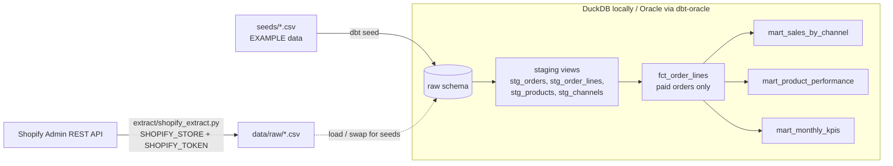

# decormama-analytics-dbt

A personal portfolio project by **Aphile Lee Dlamini**, built in Oct 2026. It is a small ELT pipeline written in Python and dbt. It models Shopify-style and marketplace sales into channel, product and monthly KPI marts, and runs automated data tests on every build.

> ⚠️ **EXAMPLE DATA ONLY.** Every row in `seeds/` is synthetic and was generated for this demo. Product names start with `EXAMPLE` and customers are `@example.com`. None of it is real Decor Mama sales, pricing or customer data.

## Architecture



| Layer | Models | Materialisation |
|---|---|---|
| Raw | `raw_orders`, `raw_order_lines`, `raw_products`, `raw_channels` (seeds) | table |
| Staging | `stg_*`: casting, trimming, lower-casing, line revenue | view |
| Facts | `fct_order_lines`: paid orders only, with VAT-exclusive revenue (`vat_rate` var) | table |
| Marts | `mart_sales_by_channel`, `mart_product_performance` (revenue rank), `mart_monthly_kpis` (orders, customers, AOV, MoM %) | table |

## How to run it

```bash
python -m venv .venv && source .venv/bin/activate
pip install -r requirements.txt
export DBT_PROFILES_DIR=.
dbt build            # seeds + models + tests, all against local DuckDB
dbt show --select mart_monthly_kpis
dbt docs generate && dbt docs serve   # lineage graph
```

### Optional: extract from Shopify

```bash
export SHOPIFY_STORE=your-shop.myshopify.com
export SHOPIFY_TOKEN=shpat_xxx          # Admin API access token (read_orders scope)
python extract/shopify_extract.py       # writes data/raw/orders.csv + order_lines.csv
```

If either variable is missing, the script exits **without making any network call**. Output goes to `data/raw/`, which is git-ignored, so real store data never gets committed. The script pages through the API using Shopify's `Link` header.

## Tests

`dbt build` runs **35 nodes** (seeds, models and tests). All of them pass on the EXAMPLE data.

- **Generic tests:** `unique` and `not_null` on keys, and `accepted_values` on `financial_status`. Relationship tests check orders → channels, lines → orders and lines → products.
- **Singular tests** (`tests/`):
  - `assert_channel_revenue_reconciles` checks that mart revenue equals fact revenue.
  - `assert_no_negative_revenue` checks there is no negative revenue and no zero or negative quantities.

## Running on Oracle

`profiles.yml` already includes an `oracle` target that uses [dbt-oracle](https://github.com/oracle/dbt-oracle). It works with Oracle 19c+, Autonomous Database on OCI, or a local XE/Free container.

```bash
pip install dbt-oracle
export DBT_ORACLE_USER=DBT_DEV DBT_ORACLE_PASSWORD=... DBT_ORACLE_HOST=localhost DBT_ORACLE_SERVICE=XEPDB1
dbt debug --target oracle
dbt build --target oracle
```

Notes for Oracle DBAs:

| Oracle concept | dbt equivalent |
|---|---|
| `CREATE OR REPLACE VIEW` | a model with `materialized: view` (staging) |
| CTAS | `materialized: table` (marts) |
| Script run order in a PL/SQL package | DAG worked out from `ref()` |
| Check constraints / DQ scripts | `tests:` in `schema.yml` plus singular tests |

- Grant the dbt user `CREATE SESSION`, `CREATE TABLE`, `CREATE VIEW` and quota on its tablespace.
- The models use portable SQL (`date_trunc`, `cast`, window functions). On Oracle, swap `date_trunc('month', x)` for `trunc(x, 'MM')`, either through a small cross-database macro or with `adapter.dispatch`. This port is left as a documented next step and has not been tested here against a live Oracle instance.
- For Autonomous Database, use the wallet/TNS settings described in the dbt-oracle docs.

## Project layout

```
extract/shopify_extract.py   Shopify Admin REST extract (env-var auth, no call without token)
seeds/                       EXAMPLE CSVs + descriptions
models/staging/              stg_* views + schema tests
models/marts/                fct + 3 marts + schema tests
macros/to_zar.sql            rounding/cast helper
tests/                       singular data tests
profiles.yml                 dev (DuckDB) and oracle targets
```
